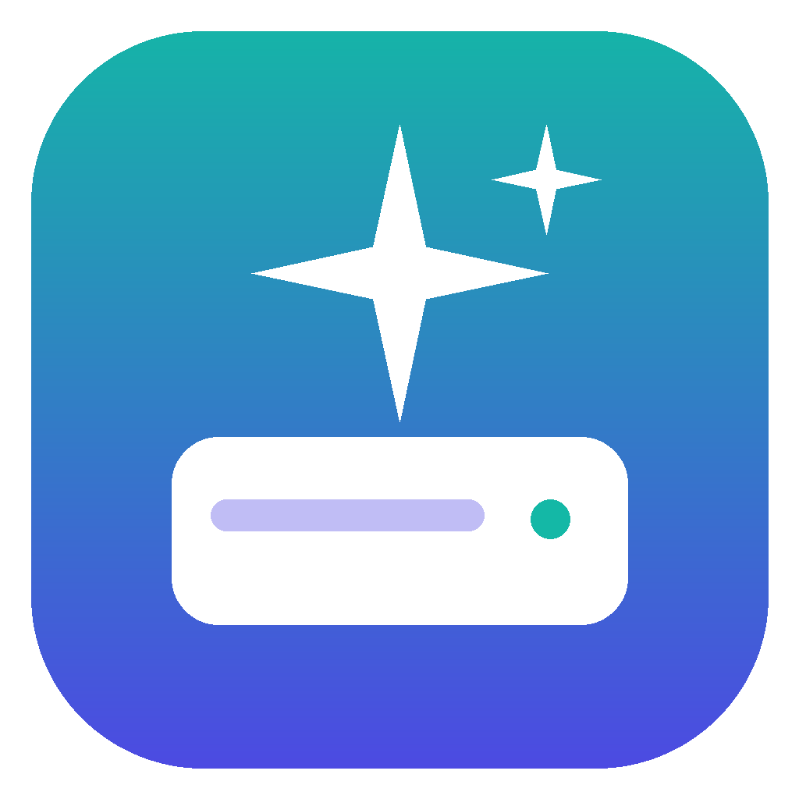
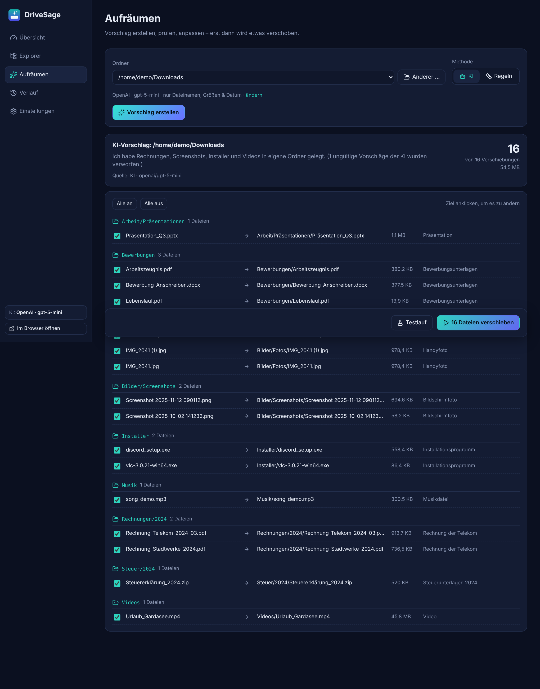
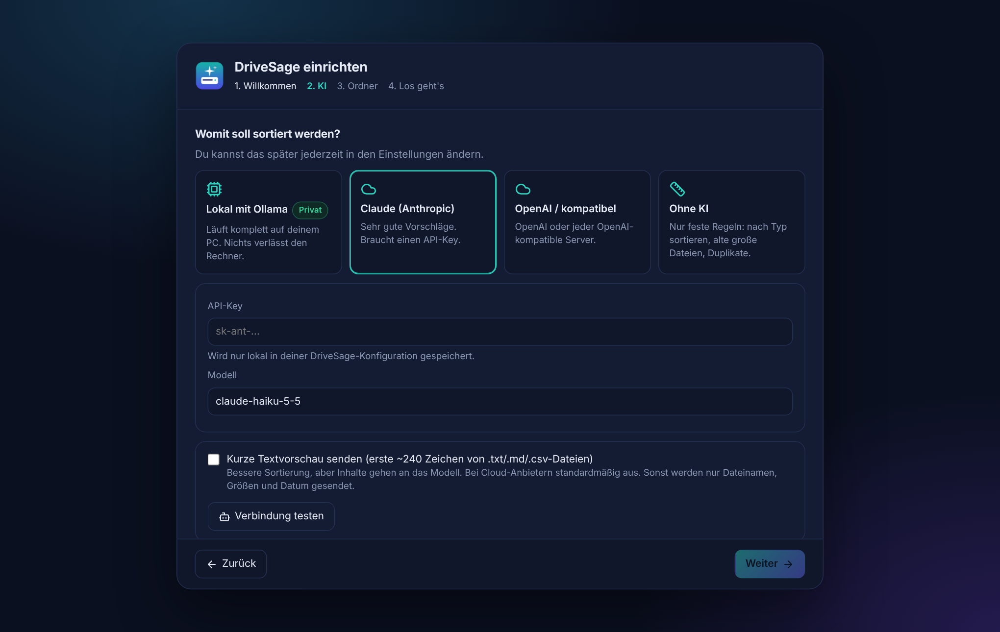
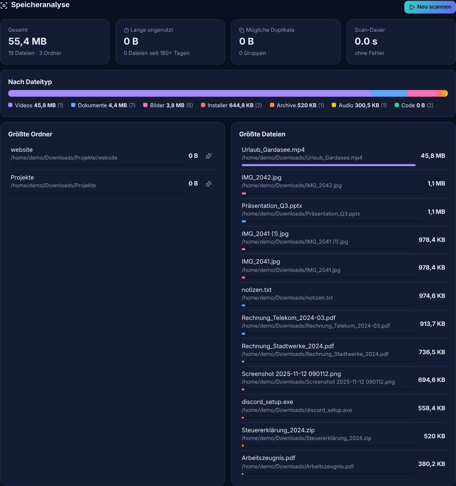
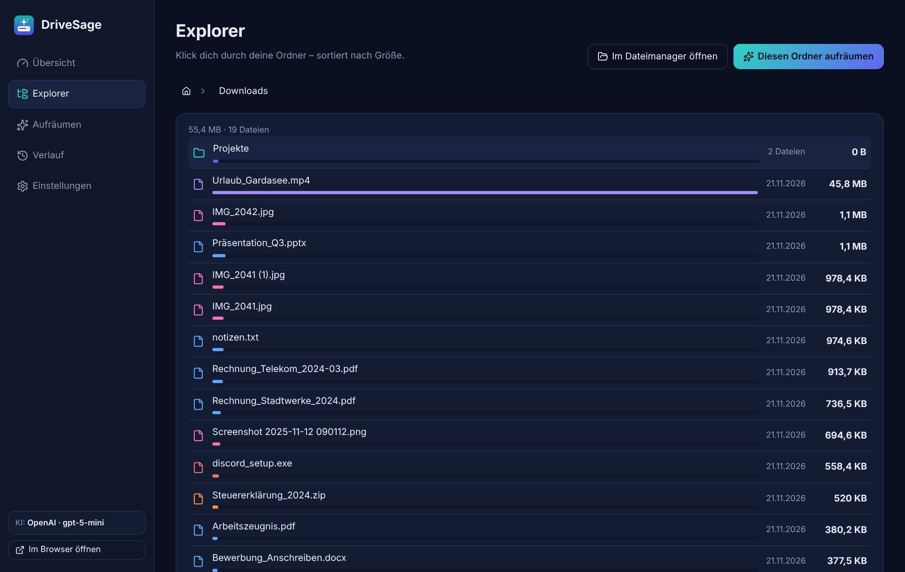
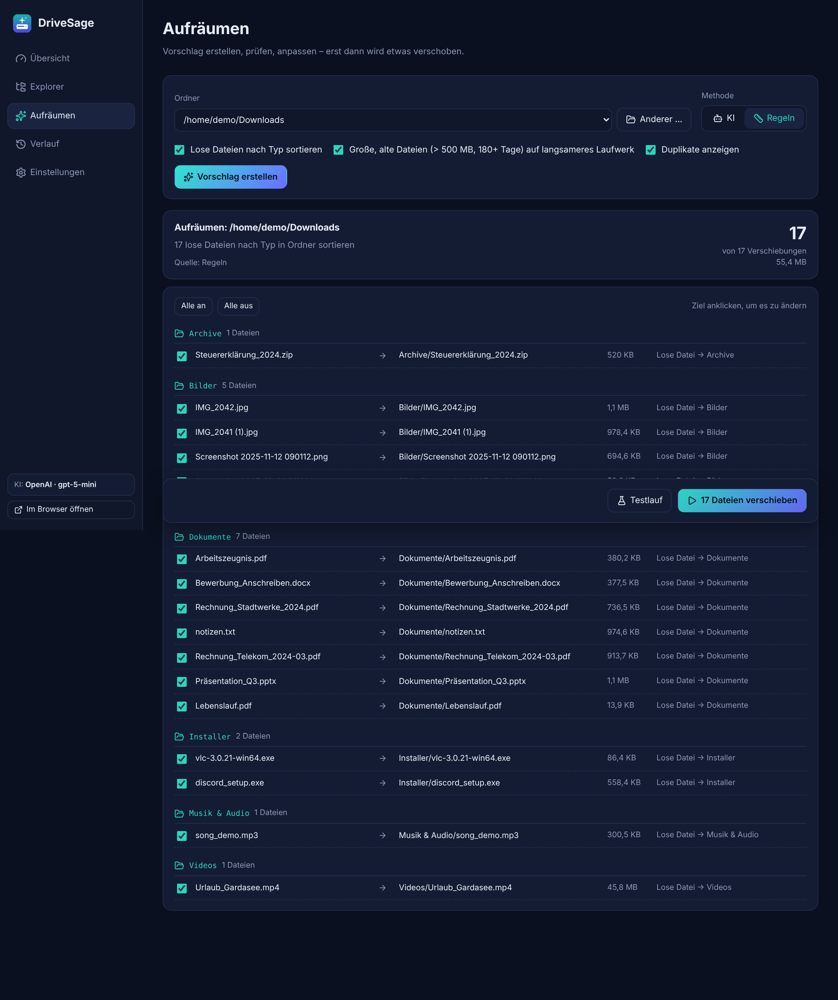

<div align="center">



# DriveSage

**See what fills your disks. Measure how fast they really are. Let AI tidy up — safely.**

Disk analyzer + drive benchmark + AI file organizer in one app.
Local-first (Ollama), or bring your own Claude / OpenAI key — or use plain rules without any AI.

[](https://github.com/swulfen13/drivesage/actions/workflows/ci.yml)


[Download](#-download) · [Features](#-features) · [Safety](#-safety-first) · [Build](#-build-from-source) · [Roadmap](ROADMAP.md) · [🇩🇪 Deutsch](#-deutsch)



</div>

---

## Why DriveSage?

There are many AI file organizers, but they only look at folders. DriveSage also knows your **hardware**:
it measures every drive (sequential read/write, random 4K) and can suggest things like

> *“These 80 GB of videos haven't been opened in a year → move them from your NVMe to the big HDD.”*

…while the AI groups the rest of your mess into a clean structure (`Rechnungen/2024`, `Bewerbungen`, `Screenshots`, …).
You review every single move before anything happens, and every run can be undone with one click.

## ✨ Features

| | |
|---|---|
| 💽 **Drive overview** | All drives with type (SSD/HDD/external), file system, used / free space |
| ⚡ **Speed test** | Sequential read & write and random 4K IOPS — bypassing the OS cache (`FILE_FLAG_NO_BUFFERING` / `O_DIRECT`) for honest numbers |
| 📊 **Disk analysis** | Fast parallel scan (Rust + `jwalk`): size by file type, largest folders & files, long-unused data, likely duplicates |
| 🗂️ **Explorer** | Drill down through your folders, sorted by size |
| 🤖 **AI cleanup** | Ollama (local), Claude or any OpenAI-compatible API proposes a folder structure |
| 📏 **Rule mode (no AI)** | Sort loose files by type, move large + old files to a slower drive, report duplicates |
| ✅ **Review & edit** | Every move is listed — uncheck it or change its destination |
| 🧪 **Dry run** | See exactly what would happen first |
| ↩️ **Undo** | Every run is journaled and can be fully reverted |
| 🧙 **Setup wizard** | Pick your AI, download a recommended Ollama model with one click, choose folders |
| 🖥️ **Desktop app + web UI** | Native window (Tauri) — or open the same UI in your normal browser |

## 📸 Screenshots

| Setup wizard | Disk analysis |
|---|---|
|  |  |
| **Explorer** | **Rule-based plan (no AI)** |
|  |  |

## 🛡️ Safety first

Moving other people's files around is serious business. DriveSage is built so that a bug or a hallucinating model can't wreck your PC:

- **Nothing is ever deleted.** DriveSage only *moves* files. Duplicates are reported, never removed automatically.
- **You approve every move.** Plans are proposals; you can toggle and edit each action, and run a dry run first.
- **Undo for everything.** Each move is written to a journal *as it happens*; a run can be reverted in one click. Folders DriveSage created are removed again only if they are empty.
- **Protected areas.** `Windows`, `Program Files`, `ProgramData`, `AppData`, hidden folders, system roots, and anything inside code projects (`.git`, `package.json`, `Cargo.toml`, …) are never touched.
- **AI output is validated.** The model may only move files DriveSage listed, only to relative paths inside the chosen folder, without `..`, drive letters or extension changes. Everything else is discarded.
- **Privacy.** With Ollama, nothing leaves your machine. With cloud providers, only file names, sizes and dates are sent by default — text snippets are opt-in.
- **Locked-down local server.** The UI talks to a server on `127.0.0.1` only. Every request needs a random per-launch token and a localhost `Host` header, so other websites can't talk to it (CSRF / DNS rebinding).

## 📥 Download

Pre-built installers (Windows `.exe`/`.msi`, macOS `.dmg`, Linux `.AppImage`/`.deb`) are published on the
[**Releases page**](https://github.com/swulfen13/drivesage/releases) whenever a version tag is pushed.

> ⚠️ Early MVP (v0.1). Try it on a folder like `Downloads` first and use the dry run.

### AI options

| Option | What you need | Notes |
|---|---|---|
| **Ollama (recommended)** | [Ollama](https://ollama.com/download) installed | 100 % local. The wizard can download `qwen2.5:7b`, `llama3.2:3b` or `gemma3:4b` for you |
| **Claude** | Anthropic API key | Default model `claude-haiku-5-5`, editable |
| **OpenAI / compatible** | API key (+ base URL) | Works with OpenAI, LM Studio, Groq, OpenRouter, … |
| **No AI** | nothing | Rule-based plans only |

## 🏗️ Architecture

```
┌──────────────────────────────┐     ┌──────────────────────────────┐
│ Desktop app (Tauri 2)        │     │ drivesage-web (CLI)          │
│ native window                │     │ opens your browser           │
└──────────────┬───────────────┘     └──────────────┬───────────────┘
               └──────────────┬─────────────────────┘
                 ┌────────────▼────────────┐   React UI (embedded)
                 │ drivesage-server (axum) │◄─ http://127.0.0.1:<port>/#token=…
                 └────────────┬────────────┘
                 ┌────────────▼────────────┐
                 │ drivesage-core          │  scan · drives · bench · rules
                 │                         │  ai (Ollama/OpenAI/Claude) · plan + journal/undo
                 └─────────────────────────┘
```

More details in [docs/ARCHITECTURE.md](docs/ARCHITECTURE.md).

```
crates/core     Rust library: all the logic (unit-tested)
crates/server   Local HTTP API + embedded web UI, binary `drivesage-web`
src-tauri       Desktop app shell
web             React 19 + TypeScript + Vite UI
```

## 🔧 Build from source

Requirements: [Rust](https://rustup.rs) (stable), [Node.js](https://nodejs.org) 20+, and on Windows the
[Tauri prerequisites](https://v2.tauri.app/start/prerequisites/) (WebView2 is preinstalled on Windows 10/11).

```bash
git clone https://github.com/swulfen13/drivesage.git
cd drivesage
npm install            # Tauri CLI
npm --prefix web install

# Web version: builds the UI, starts the server and opens your browser
npm run web

# Desktop app (dev)
npm run app:dev

# Installers for your OS → target/release/bundle/
npm run app:build
```

Run the tests:

```bash
cargo test -p drivesage-core
```

UI development with hot reload: start `cargo run -p drivesage-server --bin drivesage-web -- --port 47811 --no-open`,
then `npm run dev:web` and open `http://localhost:5173/#token=<token from the server output>`.

## 🗺️ Roadmap

See [ROADMAP.md](ROADMAP.md). Highlights: AI-based drive tiering, PDF/image content understanding, scheduled cleanups,
NTFS MFT fast-scan, SMART health data, English UI.

## 🤝 Contributing

Issues and pull requests are welcome — see [CONTRIBUTING.md](CONTRIBUTING.md).

## 📄 License

[MIT](LICENSE) © Paul Friepes

---

## 🇩🇪 Deutsch

**DriveSage** zeigt dir, was auf deinen Laufwerken Platz frisst, misst, wie schnell sie wirklich sind (Lesen, Schreiben, 4K zufällig),
und räumt mit KI oder festen Regeln auf. Das Besondere: DriveSage kennt deine Hardware und schlägt z. B. vor, alte große Dateien
von der schnellen SSD auf die langsame HDD zu verschieben.

- **Lokal mit Ollama** (nichts verlässt den PC), **Claude** oder **OpenAI** per API-Key, oder **ganz ohne KI** nur mit Regeln
- **Setup-Wizard**: KI auswählen, empfohlenes Modell mit einem Klick laden, Ordner wählen
- **Du entscheidest**: Jeder Vorschlag wird angezeigt und kann abgewählt oder geändert werden. Davor gibt es einen Testlauf.
- **Nichts wird gelöscht, alles ist rückgängig zu machen**: nur Verschieben, mit Protokoll und Undo-Knopf
- **System bleibt tabu**: Windows, Programme, AppData und Code-Projekte werden nie angefasst
- **Desktop-App oder Browser**: Die gleiche Oberfläche läuft im eigenen Fenster oder im normalen Browser

Installer gibt es unter [Releases](https://github.com/swulfen13/drivesage/releases). Zum Selbstbauen siehe [Build from source](#-build-from-source).
